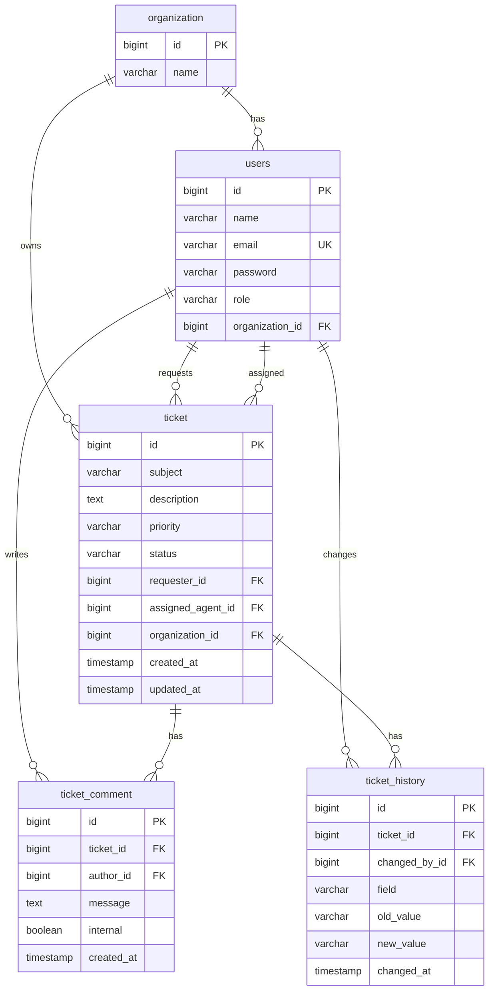

# Helpdesk Ticketing

## Overview
Spring Boot helpdesk with JWT auth and per-organization tickets. Persistence is **Spring JDBC** (`NamedParameterJdbcTemplate` + `schema.sql`), not JPA. Sign up creates a new organization (you become `ORG_ADMIN`); then add agents/customers from Users.

## ER diagram
Tables and FKs match `src/main/resources/schema.sql`.



- `users.role`: `ORG_ADMIN` | `SUPPORT_AGENT` | `CUSTOMER`
- `ticket.priority`: `LOW` | `MEDIUM` | `HIGH`
- `ticket.status`: `OPEN` | `IN_PROGRESS` | `CLOSED`
- `ticket_comment.internal`: staff-only notes; customers never see these

## Prerequisites
- Java 17
- Docker, or a local PostgreSQL database named `helpdesk` (user/password `postgres`)

## Setup & run
```bash
docker compose up -d
./mvnw spring-boot:run
```
Windows: `mvnw.cmd spring-boot:run`

Override DB with `SPRING_DATASOURCE_URL`, `SPRING_DATASOURCE_USERNAME`, `SPRING_DATASOURCE_PASSWORD` (defaults: `jdbc:postgresql://localhost:5432/helpdesk`, `postgres` / `postgres`).

## URLs
- UI: http://localhost:8080
- Swagger: http://localhost:8080/swagger-ui.html

## Auth
- Sign up: http://localhost:8080/signup.html (`POST /api/auth/signup`) — emails on a company domain (default `@kloudspot.in`) become `ORG_ADMIN` with org-wide access. Other emails become `CUSTOMER` and join that org by name (e.g. `kloudspot.in`).
- Login: http://localhost:8080/login.html (`POST /api/auth/login`)
- Org admin creates extra users at **Users** (`POST /api/users`)

## Tests
```bash
./mvnw test
```

## Tenant isolation
`organizationId` comes from the JWT user. Every query is filtered by that org. Another tenant’s ticket id returns **404** (not 403), so existence is not leaked.

## Design
Code is grouped by feature (`user`, `ticket`, `auth`, `organization`). Each feature has `controller`, `service`, `repository`, `model`, `dto`, and `enums` as needed. Auth also has `util` (JWT) and `filter`. Customers only see their own tickets and public comments; staff see org-wide tickets and internal notes.

## API overview
| Method | Path | Notes |
|---|---|---|
| POST | `/api/auth/signup` | New org + admin, returns JWT |
| POST | `/api/auth/login` | JWT |
| GET | `/api/me` | Current user |
| GET | `/api/tickets` | Filters: status, priority, assignedAgentId, search, page |
| POST | `/api/tickets` | Create |
| GET | `/api/tickets/{id}` | Detail + comments + history |
| PUT | `/api/tickets/{id}` | Staff: status/assign/priority; customer → 403 on status |
| POST | `/api/tickets/{id}/comments` | `internal: true` staff-only |
| GET | `/api/users` | Staff, same org |
| POST | `/api/users` | Org admin creates users |

Send `Authorization: Bearer <token>` on `/api/**` except login and signup.

## Assumptions
- Email is globally unique
- JWT is stored in `localStorage` for a simple UI
- No refresh tokens
- No email notifications

## Known limitations / not implemented
- No refresh tokens, logout blacklist, or email
- No attachments, SLA, or inbound email
- JWT secret is a config default, not rotated
- CSRF is not used on the JWT API; UI auth is token-in-header, not session cookies
